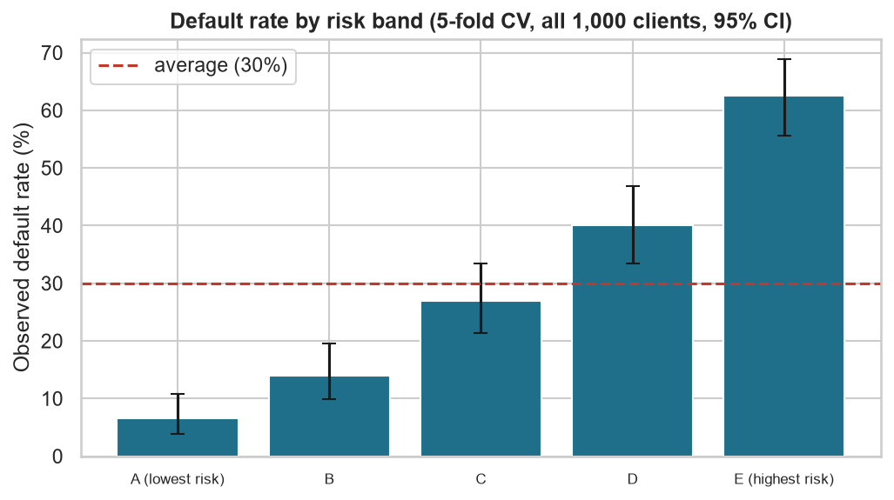

# Étude du risque de crédit et de l'inclusion financière

**Français** | [English](README_en.md)

**Quels facteurs sont associés au défaut de remboursement, et comment une banque peut-elle évaluer de manière équitable les clients mal desservis ?**

**Chengho Fongang Marie Louise**

Analyse statistique et modèle transparent sur 1 000 vrais crédits bancaires (données publiques),
testé sur des clients que le modèle n'avait jamais vus, avec un audit d'équité.

- 📓 **Notebook pas à pas :** [en français](notebooks/etude_risque_credit.ipynb) · [en anglais](notebooks/credit_risk_study.ipynb)
- 📄 **Rapport complet :** [français (PDF)](report/rapport_fr.pdf) · [anglais (PDF)](report/report_en.pdf)



*Le modèle classe les clients en 5 groupes de même taille : le taux de défaut passe de 6,5 % pour
le groupe le plus sûr à 62,5 % pour le plus risqué.*

## Principaux résultats

- **Le compte courant est le signal d'alerte le plus fort :** 49 % des clients sans compte courant
  ont fait défaut, contre 12 % des clients avec un bon solde.
- **Un modèle simple suffit à bien trier les clients :** une régression logistique, facile à
  expliquer, classe correctement 4 paires de clients sur 5 (un bon et un mauvais payeur).
- **Le seuil habituel de 50 % est un mauvais choix :** il coûte plus cher que de tout refuser,
  car il accepte 44 % des futurs défaillants.
- **Retirer l'âge du modèle ne supprime pas l'écart lié à l'âge :** les moins de 25 ans sont
  acceptés dans 28 % des cas, contre 43 % pour les autres.
- **La meilleure règle réduit les pertes de 22 %, mais refuse la moitié des bons clients :** c'est
  le vrai arbitrage entre risque financier et accès au crédit. Avec le taux de défaut réel de la
  banque (environ 5 %), 87 % des demandeurs seraient acceptés au lieu de 40 %.

## Compétences mobilisées

- **Préparation des données et SQL :** nettoyage, correction de la documentation des données, base SQLite, requêtes d'analyse.
- **Statistiques :** tests du khi-deux et de Mann-Whitney, correction pour tests multiples, régression logistique (odds ratios).
- **Modélisation :** apprentissage/test, validation croisée, classes déséquilibrées, calibrage des probabilités.
- **Aide à la décision :** seuil basé sur les coûts, comparaison avec des règles simples, segmentation en classes de risque.
- **IA responsable :** explication des décisions (SHAP), audit d'équité avec intervalles de confiance.
- **Communication :** rapport en français et en anglais, notebook commenté, références scientifiques.

**Outils :** Python, pandas, SQL (SQLite), SciPy, statsmodels, scikit-learn, SHAP, matplotlib.

## Résultats détaillés

*Cette partie s'adresse aux lecteurs techniques.*

**Un point important sur les données.** La table des codes fournie avec ce jeu de données est
fausse pour 8 des 20 variables (Grömping, 2019) : par exemple, « pas de compte courant » et
« solde ≥ 200 DM » sont inversés, et le sexe ne peut pas être retrouvé. J'ai remarqué le problème
parce que les premiers résultats n'avaient pas de sens, puis j'ai appliqué la table corrigée.

| Étape | Méthode | Résultat |
| --- | --- | --- |
| Facteurs (Q1) | Khi-deux + V de Cramér, Mann-Whitney U, Bonferroni, régression logistique | 10 variables sur 20 significatives. Les plus fortes : compte courant (V = 0,35), durée, historique de crédit, épargne |
| Modèle (Q2) | Régression logistique sans sexe, âge ni statut de travailleur étranger ; 75 % apprentissage / 25 % test | ROC-AUC sur le test = 0,80 |
| Déséquilibre des classes | Modèle normal vs `class_weight="balanced"` (validation croisée à 5 blocs) | Même ROC-AUC (0,759 vs 0,758), mais le modèle « équilibré » surestime la probabilité de défaut (43,5 % prédit vs 30 % réel). Je garde le modèle normal |
| Seuil (Q3) | Matrice des coûts 5:1 → seuil théorique 1/6 = 0,167 (Elkan, 2001) ; meilleur seuil en validation croisée = 0,16 | Coût par client : 0,544 contre 0,700 pour « tout refuser » (−22 %) et 1,500 pour « tout accepter » |
| Classes de risque | Scores de validation croisée pour les 1 000 clients, 5 classes, IC de Wilson à 95 % | De 6,5 % [3,8–10,8] à 62,5 % [55,6–68,9] de défaut |
| Explications | SHAP (vérifié : coefficient × (valeur − moyenne)) | Variables clés : compte courant, historique de crédit, épargne, durée |
| Équité (Q4) | Impact disparate et égalité des chances, IC bootstrap à 95 % (2 000 tirages) | Âge ≤ 25 : impact disparate = 0,65 [0,50–0,81]. Travailleurs étrangers (37 personnes) : 1,08 [0,71–1,50], pas de conclusion possible |

Le chiffre de 22 % est volontairement comparé à la meilleure règle simple (« tout refuser »).
La comparaison avec « tout accepter » donnerait 64 %, mais elle serait trop facile.

## Limites et pistes d'amélioration

**Limites**
- Seuls les clients acceptés figurent dans les données (biais de sélection), et les mauvais
  crédits ont été sur-représentés (30 % dans l'échantillon, environ 5 % en réalité).
- Données petites et anciennes : 1 000 crédits du sud de l'Allemagne, 1973-1975.
- Le sexe n'est pas audité (impossible à retrouver), et seuls 37 clients sont des travailleurs
  étrangers.
- Ces résultats sont des corrélations : ils ne prouvent pas qu'une personne est solvable ou non.

**Pistes d'amélioration**
- Tester des méthodes qui réduisent l'écart lié à l'âge et mesurer leur coût (Kozodoi et al., 2022).
- Remplacer la matrice 5:1 par les vrais gains et pertes d'une banque.
- Comparer la régression logistique à un modèle plus complexe (par exemple le gradient boosting).
- Refaire l'étude sur des données récentes et plus grandes.

## Exécution

```bash
pip install -r requirements.txt
python src/run_all.py
```

La graine aléatoire est fixée : chaque exécution donne les mêmes résultats.

## Fichiers

```
data/raw/            german.data (données d'origine) et german.doc (documentation d'origine)
data/processed/      CSV nettoyé et base SQLite (créés par l'étape 1)
src/
  common.py          paramètres, table des codes corrigée, chargement des données, modèle et coûts
  01_data_prep.py    étape 1 : préparation des données et requêtes SQL
  02_statistics.py   étape 2 : khi-deux, Mann-Whitney, régression logistique (odds ratios)
  03_model.py        étape 3 : modèle, déséquilibre des classes, seuil de décision, classes de risque
  04_shap.py         étape 4 : explications SHAP
  05_fairness.py     étape 5 : audit d'équité avec intervalles de confiance bootstrap
  run_all.py         lance les étapes 1 à 5
notebooks/           notebooks pas à pas avec les résultats (français et anglais)
results/             graphiques, tableaux et modèle enregistré (créés par les scripts)
report/              rapport complet en français et en anglais (Markdown et PDF)
```

## Sources

- **Données :** Hofmann, H. (1994). *Statlog (German Credit Data)*. UCI Machine Learning Repository. https://doi.org/10.24432/C5NC77
- **Table des codes corrigée :** Grömping, U. (2019). *South German Credit Data: Correcting a Widely Used Data Set*. Report 4/2019, Beuth University of Applied Sciences Berlin.
- **Seuil basé sur les coûts :** Elkan, C. (2001). The foundations of cost-sensitive learning. *IJCAI*.
- **Équité en notation de crédit :** Kozodoi, N., Jacob, J., & Lessmann, S. (2022). Fairness in credit scoring. *European Journal of Operational Research, 297*(3).

La liste complète des 34 références se trouve à la fin de chaque rapport.
