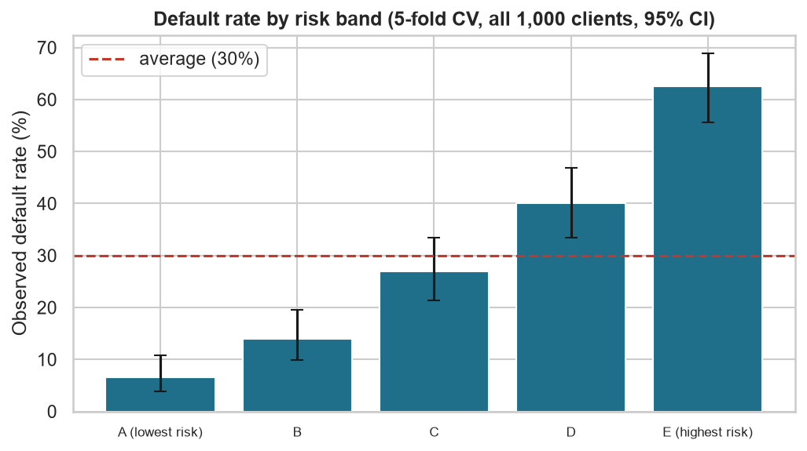

# Credit Risk & Financial Inclusion Study

[Français](README.md) | **English**

**Which factors are associated with loan default, and how can a bank evaluate underserved customers fairly?**

**Chengho Fongang Marie Louise**

Statistical analysis and a transparent model on 1,000 real bank loans (public data), tested on
clients the model had never seen, with a fairness audit.

- 📓 **Step-by-step notebook:** [English](notebooks/credit_risk_study.ipynb) · [French](notebooks/etude_risque_credit.ipynb)
- 📄 **Full report:** [English (PDF)](report/report_en.pdf) · [French (PDF)](report/rapport_fr.pdf)



*The model sorts clients into 5 groups of equal size: the default rate goes from 6.5% in the
safest group to 62.5% in the riskiest.*

## Key findings

- **The checking account is the strongest warning sign:** 49% of clients without a checking
  account defaulted, compared with 12% of clients with a good balance.
- **A simple model is enough to sort clients well:** a logistic regression, easy to explain,
  ranks 4 out of 5 pairs of clients correctly (one good and one bad payer).
- **The usual 50% threshold is a bad choice:** it costs more than refusing everyone, because it
  approves 44% of future defaulters.
- **Removing age from the model does not remove the age gap:** clients aged 25 or less are
  approved 28% of the time, compared with 43% for older clients.
- **The best rule cuts losses by 22%, but refuses half of the good clients:** this is the real
  trade-off between financial risk and access to credit. With the bank's real default rate
  (about 5%), 87% of applicants would be approved instead of 40%.

## Skills shown

- **Data preparation and SQL:** cleaning, correcting the data documentation, SQLite database, analysis queries.
- **Statistics:** chi-square and Mann-Whitney tests, correction for multiple tests, logistic regression (odds ratios).
- **Modelling:** train/test split, cross-validation, imbalanced classes, probability calibration.
- **Decision support:** cost-based threshold, comparison with simple rules, risk segmentation.
- **Responsible AI:** explaining decisions (SHAP), fairness audit with confidence intervals.
- **Communication:** report in English and French, commented notebook, scientific references.

**Tools:** Python, pandas, SQL (SQLite), SciPy, statsmodels, scikit-learn, SHAP, matplotlib.

## Detailed results

*This part is for technical readers.*

**An important point about the data.** The code table that comes with this dataset is wrong for
8 of the 20 variables (Grömping, 2019): for example, "no checking account" and "balance ≥ 200 DM"
are swapped, and sex cannot be recovered. I noticed the problem because the first results did
not make sense, then applied the corrected table.

| Step | Method | Result |
| --- | --- | --- |
| Factors (Q1) | Chi-square + Cramér's V, Mann-Whitney U, Bonferroni, logistic regression | 10 of 20 variables significant. Strongest: checking account (V = 0.35), duration, credit history, savings |
| Model (Q2) | Logistic regression without sex, age or foreign-worker status; 75% train / 25% test | Test ROC-AUC = 0.80 |
| Class imbalance | Normal model vs `class_weight="balanced"` (5-fold cross-validation) | Same ROC-AUC (0.759 vs 0.758), but the "balanced" model overestimates the default probability (43.5% predicted vs 30% real). I keep the normal model |
| Threshold (Q3) | 5:1 cost matrix → theoretical threshold 1/6 = 0.167 (Elkan, 2001); best threshold in cross-validation = 0.16 | Cost per client: 0.544 vs 0.700 for "reject everyone" (−22%) and 1.500 for "approve everyone" |
| Risk bands | Cross-validated scores for all 1,000 clients, 5 bands, 95% Wilson CI | From 6.5% [3.8–10.8] to 62.5% [55.6–68.9] default |
| Explanations | SHAP (checked: coefficient × (value − mean)) | Key features: checking account, credit history, savings, duration |
| Fairness (Q4) | Disparate impact and equal opportunity, 95% bootstrap CI (2,000 resamples) | Age ≤ 25: disparate impact = 0.65 [0.50–0.81]. Foreign workers (37 people): 1.08 [0.71–1.50], no conclusion possible |

The 22% figure is deliberately compared with the best simple rule ("reject everyone"). The
comparison with "approve everyone" would give 64%, but it would be too easy.

## Limitations and next steps

**Limitations**
- Only approved clients are in the data (selection bias), and bad credits were oversampled
  (30% in the sample, about 5% in reality).
- Small and old data: 1,000 loans from southern Germany, 1973-1975.
- Sex is not audited (it cannot be recovered), and only 37 clients are foreign workers.
- These results are correlations: they do not prove that any person is or is not creditworthy.

**Next steps**
- Test methods that reduce the age gap and measure their cost (Kozodoi et al., 2022).
- Replace the 5:1 matrix with a bank's real profits and losses.
- Compare the logistic regression with a more complex model (for example gradient boosting).
- Repeat the study on recent and larger data.

## How to run

```bash
pip install -r requirements.txt
python src/run_all.py
```

The random seed is fixed, so every run gives the same results.

## Files

```
data/raw/            german.data (original data) and german.doc (original documentation)
data/processed/      clean CSV and SQLite database (created by step 1)
src/
  common.py          settings, corrected code table, data loading, model and cost functions
  01_data_prep.py    step 1: data preparation and SQL queries
  02_statistics.py   step 2: chi-square, Mann-Whitney, logistic regression (odds ratios)
  03_model.py        step 3: model, class imbalance, decision threshold, risk bands
  04_shap.py         step 4: SHAP explanations
  05_fairness.py     step 5: fairness audit with bootstrap confidence intervals
  run_all.py         runs steps 1 to 5
notebooks/           step-by-step notebooks with results (English and French)
results/             figures, tables and the saved model (created by the scripts)
report/              full report in English and French (Markdown and PDF)
```

## Data sources

- **Data:** Hofmann, H. (1994). *Statlog (German Credit Data)*. UCI Machine Learning Repository. https://doi.org/10.24432/C5NC77
- **Corrected code table:** Grömping, U. (2019). *South German Credit Data: Correcting a Widely Used Data Set*. Report 4/2019, Beuth University of Applied Sciences Berlin.
- **Cost-based threshold:** Elkan, C. (2001). The foundations of cost-sensitive learning. *IJCAI*.
- **Fairness in credit scoring:** Kozodoi, N., Jacob, J., & Lessmann, S. (2022). Fairness in credit scoring. *European Journal of Operational Research, 297*(3).

The full list of 34 references is at the end of each report.
