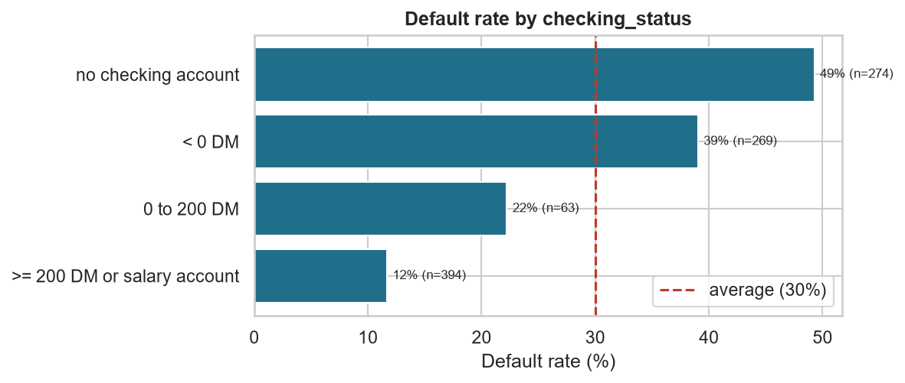
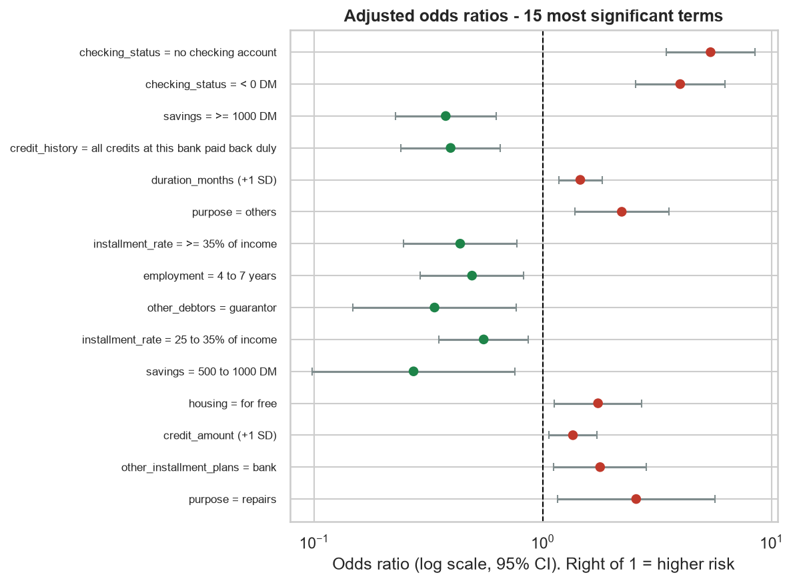
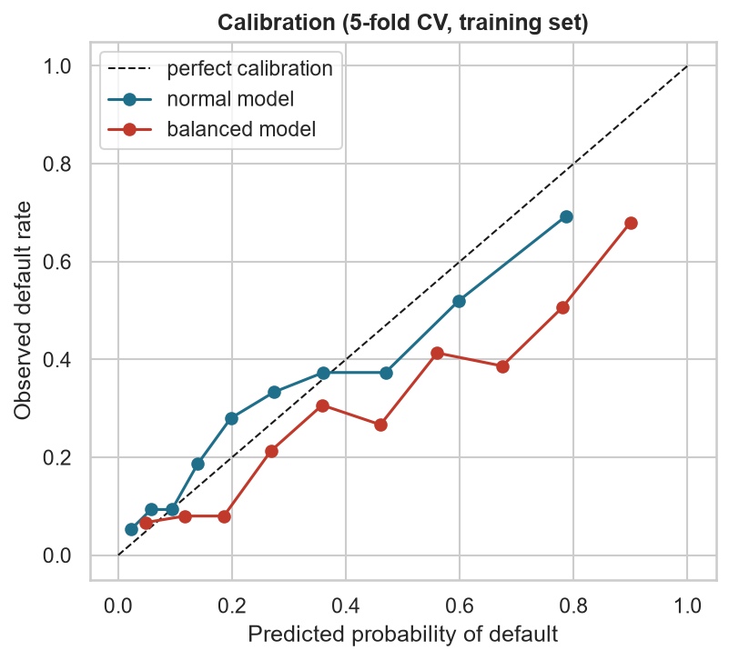
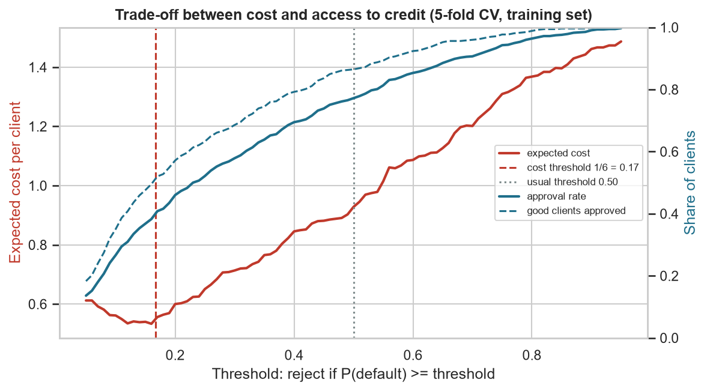
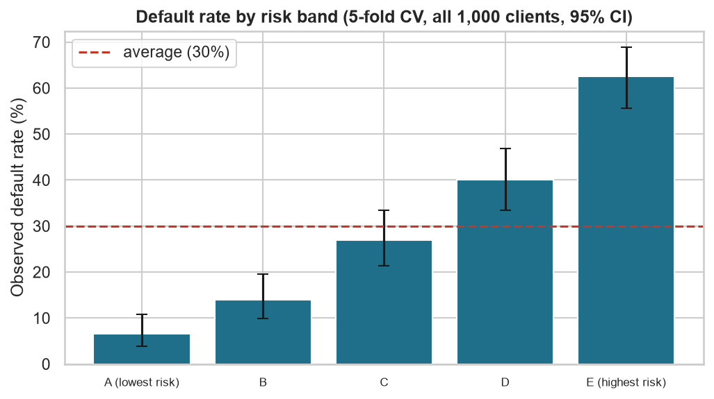
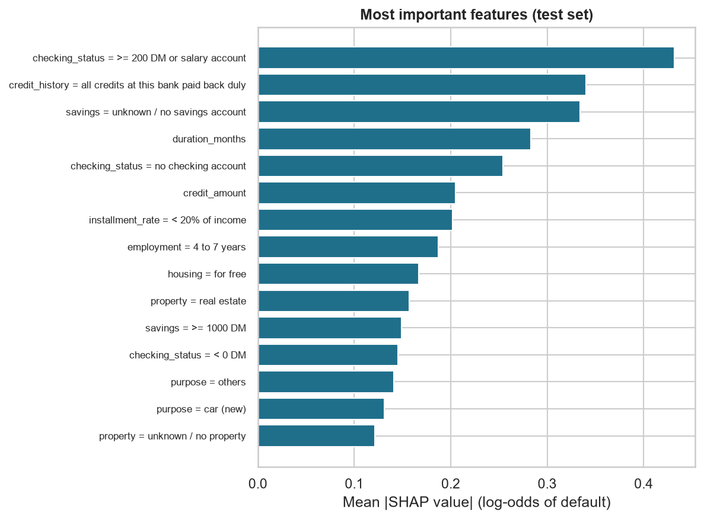
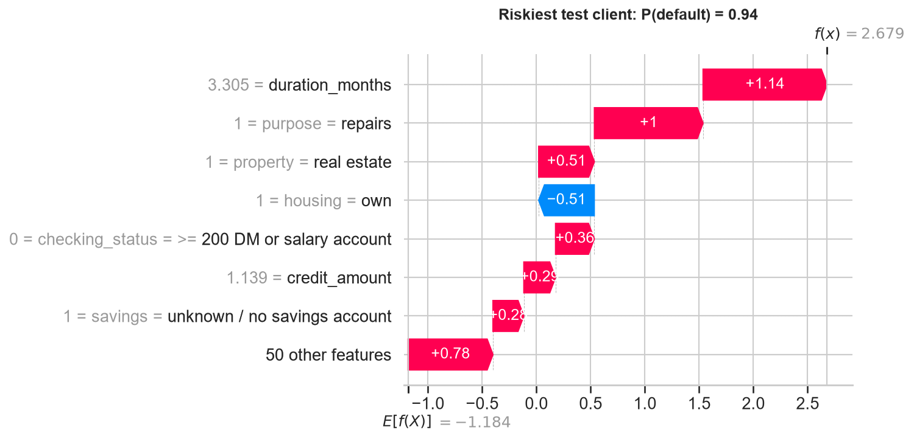
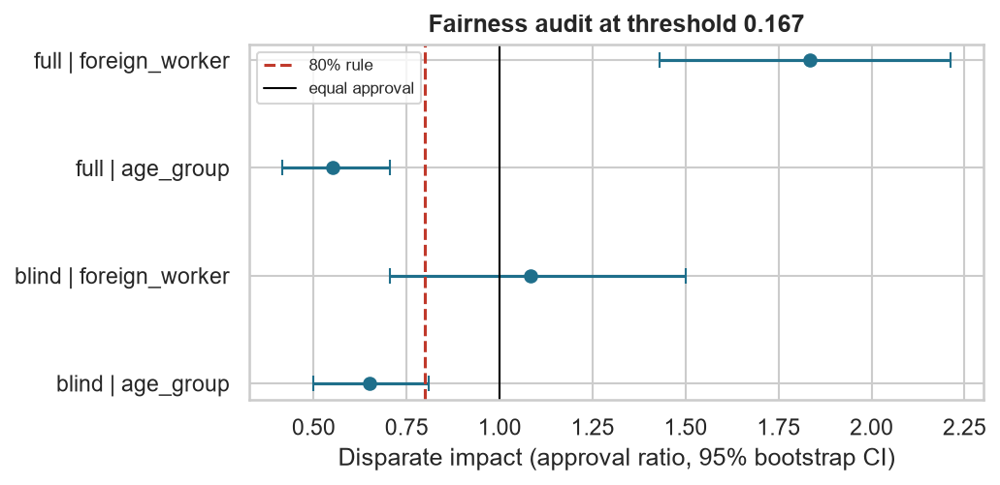

# Abréviations

| Abréviation | Signification |
| --- | --- |
| AUC | *Area Under the Curve* : aire sous la courbe ROC |
| CSV | *Comma-Separated Values* : fichier tableau simple |
| DI | *Disparate Impact* : taux d'acceptation d'un groupe divisé par celui d'un autre groupe |
| DM | Deutsche Mark (monnaie allemande avant l'euro) |
| EO | *Equal Opportunity* (égalité des chances) : les bons payeurs doivent avoir la même chance d'être acceptés dans chaque groupe |
| FN | Faux négatif : client accepté qui fait défaut |
| FP | Faux positif : bon client refusé |
| IA | Intelligence artificielle |
| IC | Intervalle de confiance (ici toujours à 95 %) |
| OR | *Odds Ratio* (rapport des cotes) |
| PD | Probabilité de défaut |
| ROC | *Receiver Operating Characteristic* : courbe des vrais positifs contre les faux positifs |
| SHAP | *SHapley Additive exPlanations* : méthode pour expliquer chaque prédiction |
| SQL | *Structured Query Language* : langage pour interroger une base de données |
| UCI | Université de Californie à Irvine (héberge le *Machine Learning Repository*) |
| UE | Union européenne |
| VC | Validation croisée |

# 1. Résumé

Ce projet étudie 1 000 anciens crédits à la consommation d'une banque allemande. Il pose deux
questions : quelles caractéristiques des clients sont associées au défaut de paiement, et
comment un prêteur peut-il évaluer de manière plus équitable les clients mal desservis ?

| Thème | Résultat principal |
| --- | --- |
| Données | 1 000 crédits, 30 % de mauvais crédits. La table des codes d'origine était fausse pour 8 variables ; nous utilisons la table corrigée de Grömping (2019). |
| Facteurs les plus forts | Compte courant, historique de crédit, durée du prêt et épargne. |
| Modèle | Régression logistique sans sexe, âge ni statut de travailleur étranger. ROC-AUC sur le test = 0,80. |
| Règle de décision | Seuil P(défaut) = 1/6, issu de la matrice des coûts 5:1. Économie de 22 % par rapport à la meilleure règle simple (« tout refuser »). |
| Accès au crédit | À ce seuil, seulement 40 % des demandeurs et 51 % des bons clients sont acceptés. |
| Classes de risque | Le taux de défaut va de 6,5 % (20 % les plus sûrs) à 62,5 % (20 % les plus risqués). |
| Équité | Les clients de 25 ans ou moins sont beaucoup moins acceptés, alors que le modèle n'utilise pas l'âge (DI = 0,65). |

**Message principal.** Un modèle simple et transparent sépare bien le risque. Mais le seuil de
décision est un choix économique et social, pas seulement technique. L'équité doit être
mesurée, pas supposée. Ces résultats sont des corrélations historiques des années 1970. Ils ne
prouvent pas qu'une personne est solvable ou non.

# 2. Problématique et questions

Une banque doit estimer le risque qu'un emprunteur ne rembourse pas. Si elle prête à trop de
clients risqués, elle perd de l'argent. Si elle est trop stricte, de bons clients perdent
l'accès au crédit. C'est un vrai problème d'inclusion financière : en 2021, environ
1,4 milliard d'adultes dans le monde n'avaient toujours pas de compte bancaire
(Demirgüç-Kunt et al., 2022), et les personnes avec un historique financier court ou atypique
sont souvent refusées. Dans l'Union européenne, les systèmes de notation de crédit sont
désormais classés comme systèmes d'IA « à haut risque » (Union européenne, 2024) : ils doivent
être transparents et contrôlés contre la discrimination.

Nous répondons à quatre questions :

- **Q1.** Quelles caractéristiques des clients sont associées au défaut ?
- **Q2.** Un modèle simple et interprétable peut-il séparer bons et mauvais clients ?
- **Q3.** Quelle règle de décision coûte le moins, et que signifie-t-elle pour l'accès au crédit ?
- **Q4.** Le modèle traite-t-il certains groupes moins bien, même sans utiliser de données sensibles ?

# 3. Données

## 3.1 Source

Nous utilisons le jeu de données public **Statlog (German Credit Data)** du UCI Machine
Learning Repository (Hofmann, 1994). Il contient 1 000 crédits, 20 caractéristiques du client
et du prêt, et une cible : bon crédit (remboursé comme prévu) ou mauvais crédit (non remboursé
comme prévu). 30 % des crédits sont mauvais. Le jeu de données est fourni avec une **matrice des
coûts** : accepter un client qui fait ensuite défaut coûte 5, refuser un bon client coûte 1.

## 3.2 Un problème important : la table des codes d'origine est fausse

Le fichier brut utilise des codes comme `A11` ou `A34`. La table des codes livrée avec les
données explique ces codes. Grömping (2019) est revenue aux sources allemandes d'origine et a
montré que cette table est **fausse pour 8 des 20 variables**. Voici les corrections les plus
importantes :

| Variable | Libellé d'origine (faux) | Libellé correct |
| --- | --- | --- |
| checking_status A11 | solde < 0 DM | pas de compte courant |
| checking_status A14 | pas de compte courant | solde >= 200 DM ou compte salaire |
| credit_history A30 | aucun crédit pris | retards de paiement dans le passé |
| credit_history A34 | compte critique | tous les crédits dans cette banque remboursés |
| foreign_worker A201 | oui (963 clients) | non (seulement 37 travailleurs étrangers) |
| personal_status_sex A92 | femme | femme non célibataire **ou** homme célibataire |

Nous avons découvert ce problème parce que nos premiers résultats n'avaient pas de sens :
« pas de compte courant » et « compte critique » semblaient être les clients *les plus sûrs*.
Après correction, les résultats deviennent logiques (section 5.1). **Leçon :** toujours
vérifier que les résultats ont du sens, et vérifier la documentation des données.

Grömping (2019) donne deux autres informations importantes pour cette étude :

1. Les crédits datent de **1973 à 1975** et viennent d'une grande banque du sud de l'Allemagne.
2. Les mauvais crédits ont été **volontairement sur-représentés**. En réalité, seulement environ
   **5 %** des crédits étaient mauvais, et non 30 %. La banque a choisi 300 mauvais et 700 bons
   crédits pour avoir assez de cas de défaut.

## 3.3 Limites des données

- **Biais de sélection.** Nous ne voyons que les clients qui *ont obtenu* un crédit. Les
  personnes refusées sont absentes, donc nous ne savons pas si elles auraient remboursé
  (Thomas et al., 2017 ; Banasik & Crook, 2007).
- **Données anciennes et petites.** 1 000 crédits des années 1970. Les résultats montrent une
  méthode, pas la réalité d'aujourd'hui.
- **Le sexe n'est pas utilisable.** Le code A92 mélange femmes et hommes célibataires, donc le
  sexe ne peut pas être retrouvé. Nous n'auditons donc pas le sexe.
- **Très peu de travailleurs étrangers.** Seulement 37 personnes : tout résultat sur ce groupe
  est incertain.

# 4. Méthode : les cinq étapes

Toutes les étapes sont des scripts Python dans `src/`. La commande `python src/run_all.py`
exécute tout et enregistre les tableaux et les graphiques dans `results/`. La graine aléatoire
est fixée (42), donc les résultats sont toujours les mêmes.

**Étape 1 : préparation des données et SQL** (`01_data_prep.py`). Nous chargeons le fichier brut
et appliquons la table des codes corrigée. Nous stockons les données dans une base SQLite et
calculons en SQL les taux de défaut par segment (compte courant, historique, objet du crédit,
tranche d'âge).

**Étape 2 : analyse statistique** (`02_statistics.py`, question Q1).

- Pour chaque variable qualitative : un **test du khi-deux** d'indépendance et le **V de
  Cramér** pour mesurer la force du lien, de 0 (aucun lien) à 1 (lien parfait) (Agresti, 2013).
- Pour chaque variable numérique : un **test de Mann-Whitney U** (Mann & Whitney, 1947), qui ne
  suppose pas une loi normale, et la **corrélation bisériale de rang** comme taille d'effet
  (Kerby, 2014).
- Nous faisons 20 tests, donc certains pourraient être significatifs par hasard. Nous utilisons
  la **correction de Bonferroni** : chaque p-valeur est multipliée par le nombre de tests
  (Bland & Altman, 1995).
- Ensuite, une **régression logistique multivariée** montre l'effet de chaque facteur « toutes
  choses égales par ailleurs ». Nous donnons les **odds ratios** (OR) avec un IC à 95 % :
  OR > 1 signifie plus de risque, OR < 1 moins de risque (Hosmer et al., 2013). Les variables
  numériques sont standardisées : leur OR correspond à +1 écart-type.

**Étape 3 : modèle, seuil et segmentation du risque** (`03_model.py`, questions Q2 et Q3).

- *Découpage.* 75 % des données pour l'apprentissage (750 crédits), 25 % pour le test final
  (250 crédits). Le jeu de test n'est utilisé qu'une seule fois, à la fin.
- *Modèle.* Une régression logistique. C'est le modèle de référence en notation de crédit
  (Siddiqi, 2017 ; Hand & Henley, 1997) et il reste difficile à battre (Lessmann et al., 2015).
  Il est aussi facile à expliquer, ce qui compte pour des décisions importantes (Rudin, 2019).
  Nous n'utilisons **pas** le sexe (personal_status_sex), l'âge ni le statut de travailleur étranger.
- *Déséquilibre des classes.* Il y a moins de mauvais crédits (30 %) que de bons (70 %). Une
  solution courante est de donner plus de poids à la petite classe (`class_weight="balanced"`)
  (He & Garcia, 2009). Nous comparons cette option avec un modèle normal, par validation croisée
  à 5 blocs sur le jeu d'apprentissage.
- *Seuil de décision.* Nous refusons un client si P(défaut) ≥ seuil. Avec les coûts 5 (FN) et
  1 (FP), la théorie de la décision donne le seuil 1 / (1 + 5) = **0,167** (Elkan, 2001). Cette
  formule n'est valable que si les probabilités prédites sont réalistes (bien calibrées).
- *Comparaison.* Nous comparons le modèle à deux règles simples : tout accepter et tout refuser.
- *Classes de risque.* Chacun des 1 000 clients reçoit un score de validation croisée (calculé
  par un modèle qui n'a pas vu ce client) et nous les répartissons en 5 classes de même taille.
  Pour chaque classe, nous calculons le taux de défaut avec un intervalle de confiance de
  Wilson à 95 % (Wilson, 1927).

**Étape 4 : expliquer le modèle avec SHAP** (`04_shap.py`). Les valeurs SHAP montrent combien
chaque variable augmente ou diminue une prédiction (Lundberg & Lee, 2017). Pour une régression
logistique, la valeur SHAP est simplement *coefficient × (valeur du client − valeur moyenne)*
(Molnar, 2022). Notre script vérifie cette formule : la différence est nulle.

**Étape 5 : audit d'équité** (`05_fairness.py`, question Q4). Nous utilisons les scores de
validation croisée des 1 000 clients et le seuil 0,167. Groupes : âge ≤ 25 ans contre > 25 ans
(le découpage utilisé par Kamiran & Calders, 2009, sur ces données) et travailleurs étrangers
contre les autres. Nous calculons :

- **Impact disparate (DI)** : taux d'acceptation du groupe ÷ taux d'acceptation du groupe de
  référence. La « règle des 80 % » (*four-fifths rule*) signale un problème si DI < 0,8
  (EEOC, 1978 ; Feldman et al., 2015).
- **Écart d'égalité des chances (EO)** : différence de taux d'acceptation *parmi les bons
  payeurs seulement*. Les personnes qui rembourseraient doivent avoir la même chance dans
  chaque groupe (Hardt et al., 2016).
- **IC bootstrap à 95 %** : nous ré-échantillonnons les clients 2 000 fois pour voir si chaque
  chiffre est stable (Efron & Tibshirani, 1993).
- **Modèle « aveugle » contre modèle « complet »** : un modèle sans données sensibles contre un
  modèle avec l'âge et le statut de travailleur étranger, pour voir si retirer ces variables
  supprime les écarts.

# 5. Résultats

## 5.1 Qui fait défaut ? (SQL, étape 1)

| Compte courant | Clients | Taux de défaut |
| --- | --- | --- |
| pas de compte courant | 274 | **49,3 %** |
| solde < 0 DM | 269 | 39,0 % |
| 0 à 200 DM | 63 | 22,2 % |
| >= 200 DM ou compte salaire | 394 | **11,7 %** |

| Historique de crédit | Clients | Taux de défaut |
| --- | --- | --- |
| retards de paiement dans le passé | 40 | **62,5 %** |
| compte critique / crédits ailleurs | 49 | 57,1 % |
| aucun crédit / tous remboursés | 530 | 31,9 % |
| crédits en cours remboursés normalement | 88 | 31,8 % |
| tous les crédits dans cette banque remboursés | 293 | **17,1 %** |

Avec les libellés corrigés, les résultats sont logiques : les clients sans compte courant ou
avec des retards passés font le plus souvent défaut. Les clients avec un bon solde ou un bon
historique dans la banque font le moins souvent défaut. Les crédits en défaut sont aussi plus
gros (3 938 contre 2 985 DM en moyenne) et plus longs (24,9 contre 19,2 mois). Les jeunes (19 à
25 ans) font plus souvent défaut (42,1 %) que les 36 à 50 ans (23,7 %).

{width=80%}

## 5.2 Tests statistiques et régression logistique (Q1)

Après correction de Bonferroni, 10 des 20 variables sont liées de façon significative au défaut.
Les plus fortes sont :

| Variable | Taille d'effet | p-valeur Bonferroni |
| --- | --- | --- |
| checking_status | V de Cramér = 0,35 | < 0,001 |
| duration_months | r bisérial = 0,26 | < 0,001 |
| credit_history | V de Cramér = 0,25 | < 0,001 |
| savings | V de Cramér = 0,19 | < 0,001 |
| purpose | V de Cramér = 0,18 | 0,002 |
| property | V de Cramér = 0,15 | < 0,001 |
| age | r bisérial = −0,14 | 0,008 |

Tous les effets sont faibles à moyens. Aucune variable ne prédit le défaut à elle seule.

La régression logistique (référence = catégorie la plus fréquente) donne ces principaux odds ratios :

| Terme | OR | IC à 95 % | Effet |
| --- | --- | --- | --- |
| checking_status = pas de compte courant | 5,41 | 3,45 à 8,47 | plus de risque |
| checking_status = < 0 DM | 3,98 | 2,54 à 6,26 | plus de risque |
| purpose = autres | 2,21 | 1,38 à 3,56 | plus de risque |
| duration_months (+1 écart-type) | 1,46 | 1,17 à 1,81 | plus de risque |
| credit_amount (+1 écart-type) | 1,35 | 1,06 à 1,73 | plus de risque |
| savings = >= 1000 DM | 0,38 | 0,23 à 0,62 | moins de risque |
| credit_history = tous les crédits dans cette banque remboursés | 0,40 | 0,24 à 0,65 | moins de risque |
| other_debtors = garant | 0,34 | 0,15 à 0,76 | moins de risque |
| installment_rate = >= 35 % du revenu | 0,44 | 0,25 à 0,77 | moins de risque |

La référence pour checking_status est « >= 200 DM » : un client sans compte courant a donc une
cote de défaut environ 5 fois plus élevée qu'un client avec un bon solde, toutes choses égales
par ailleurs.

{width=85%}

**Un résultat surprenant.** Les clients qui remboursent une *grande* part de leur revenu
(≥ 35 %) font *moins* souvent défaut. C'est probablement un effet de **sélection** : la banque
n'acceptait des remboursements aussi lourds que pour des clients en qui elle avait confiance
pour d'autres raisons. Cela montre pourquoi il faut parler d'**associations, pas de causes**.

**Réponse à Q1.** Le compte courant, l'historique de crédit, la durée et le montant du prêt et
l'épargne sont les facteurs les plus fortement associés au défaut dans cet échantillon.

## 5.3 Performance du modèle et déséquilibre des classes (Q2)

| Modèle (VC à 5 blocs, apprentissage) | ROC-AUC | PD moyenne prédite | Taux de défaut réel | Score de Brier |
| --- | --- | --- | --- | --- |
| normal | 0,759 | 0,300 | 0,300 | 0,176 |
| équilibré (*balanced*) | 0,758 | 0,435 | 0,300 | 0,200 |

Les deux modèles classent les clients de la même façon (même ROC-AUC). Mais le modèle
« équilibré » prédit une probabilité moyenne de défaut de 43,5 % alors que le taux réel est de
30 % : ses probabilités sont trop élevées. Son score de Brier (une mesure de l'erreur sur les
probabilités ; Brier, 1950) est aussi moins bon. C'est un effet connu de la repondération
(Elkan, 2001 ; Niculescu-Mizil & Caruana, 2005). Comme la formule du seuil a besoin de
probabilités réalistes, **nous gardons le modèle normal** et nous traitons le déséquilibre avec
le seuil.

{width=55%}

Sur le jeu de test, le modèle final atteint une **ROC-AUC de 0,80**. Une AUC de 0,5 correspond
au hasard et 1,0 à un classement parfait (Fawcett, 2006) : le modèle est utile mais loin d'être
parfait.

## 5.4 Seuil de décision et arbitrage financier (Q3)

Sur le jeu d'apprentissage, le seuil le moins coûteux est 0,16, très proche de la théorie
(0,167). Résultats sur le jeu de test (250 clients) :

| Règle | Taux d'acceptation | Bons clients acceptés | Défaillants acceptés | Coût par client | Économie vs meilleure règle simple |
| --- | --- | --- | --- | --- | --- |
| Tout accepter | 100 % | 100 % | 100 % | 1,500 | — |
| Tout refuser | 0 % | 0 % | 0 % | 0,700 | référence |
| Modèle, seuil 0,50 | 73,6 % | 86,3 % | 44,0 % | 0,756 | −8 % |
| **Modèle, seuil 0,167** | **39,6 %** | **50,9 %** | **13,3 %** | **0,544** | **+22 %** |

{width=85%}

**Ce que cela signifie.**

1. Le seuil habituel de 0,50 est un mauvais choix ici. Il coûte *plus* que de tout refuser,
   car il accepte 44 % des défaillants.
2. Le seuil basé sur les coûts (0,167) est la meilleure règle, mais l'économie par rapport à
   « tout refuser » est de 22 %, pas plus. (La comparaison avec « tout accepter » donnerait
   64 %, mais cette comparaison est trop facile.)
3. Le prix à payer est l'accès au crédit : **la moitié des bons clients est refusée**. C'est le
   cœur de l'arbitrage entre risque financier et inclusion financière.
4. Le ratio 5:1 et le taux de défaut de 30 % poussent vers le refus. En réalité, seulement
   environ 5 % des crédits étaient mauvais (Grömping, 2019). Si l'on corrige les probabilités
   pour un taux de défaut de 5 % (correction des probabilités *a priori* ; Saerens et al.,
   2002 ; King & Zeng, 2001), le même seuil accepte **87 %** des demandeurs au lieu de 40 %.
   Un prêteur doit donc utiliser *son propre* taux de défaut et *ses propres* coûts. Une
   approche plus complète utiliserait les vrais gains et pertes (Verbraken et al., 2014).

## 5.5 Segmentation du risque

| Classe | Clients | Taux de défaut | IC à 95 % | Action proposée |
| --- | --- | --- | --- | --- |
| A (risque le plus faible) | 200 | 6,5 % | 3,8 % à 10,8 % | accepter, conditions standard |
| B | 200 | 14,0 % | 9,9 % à 19,5 % | accepter, conditions standard |
| C | 200 | 27,0 % | 21,3 % à 33,5 % | accepter avec un montant plus faible ou une durée plus courte |
| D | 200 | 40,0 % | 33,5 % à 46,9 % | analyse manuelle (garant, garantie) |
| E (risque le plus élevé) | 200 | 62,5 % | 55,6 % à 68,9 % | refuser, ou prêt garanti uniquement |

{width=70%}

Le taux de défaut augmente à chaque classe, et les intervalles de confiance de A et E sont très
éloignés. Au lieu d'un simple oui/non, la banque peut **adapter les conditions du prêt** à la
classe de risque (montant, durée, garant), comme c'est l'usage avec les grilles de score
(Siddiqi, 2017). Cette approche « adapter plutôt que refuser » aide l'inclusion : un client des
classes C ou D peut quand même obtenir un prêt, avec des conditions plus sûres. (Ces actions
sont des exemples, pas des politiques testées.)

## 5.6 Expliquer le modèle avec SHAP

Les variables les plus importantes (valeur SHAP absolue moyenne, jeu de test) sont :

1. checking_status = « >= 200 DM ou compte salaire » (diminue le risque)
2. credit_history = « tous les crédits dans cette banque remboursés » (diminue le risque)
3. savings = « inconnue / pas de compte d'épargne » (augmente le risque)
4. duration_months (les prêts longs augmentent le risque)
5. checking_status = « pas de compte courant » (augmente le risque)

{width=80%}

Les graphiques en cascade (*waterfall*) expliquent une décision pour un client. Par exemple,
pour le client le plus risqué du jeu de test, la longue durée du prêt et l'objet « réparations »
ajoutent le plus de risque. C'est le type d'explication qu'une banque devrait pouvoir donner à
un client refusé.

{width=85%}

Pour un modèle linéaire, SHAP n'apporte pas d'information nouvelle par rapport aux
coefficients. Son intérêt est de présenter l'information **client par client**, de façon claire.
Certains effets semblent étranges (par exemple, être propriétaire d'un bien immobilier augmente
légèrement le risque). Comme en section 5.2, ils reflètent probablement les choix passés de la
banque et ne doivent pas être sur-interprétés.

## 5.7 Audit d'équité (Q4)

| Modèle | Groupe (n) | Acceptation : groupe vs référence | DI [IC 95 %] | Écart EO [IC 95 %] |
| --- | --- | --- | --- | --- |
| aveugle | âge ≤ 25 (190) | 27,9 % vs 42,8 % | **0,65** [0,50 ; 0,81] | −12 pts [−22 ; −2] |
| aveugle | travailleur étranger (37) | 43,2 % vs 39,9 % | 1,08 [0,71 ; 1,50] | −3 pts [−20 ; +15] |
| complet | âge ≤ 25 (190) | 24,7 % vs 44,8 % | 0,55 [0,42 ; 0,70] | −18 pts [−28 ; −8] |
| complet | travailleur étranger (37) | 73,0 % vs 39,8 % | 1,84 [1,43 ; 2,21] | +24 pts [+8 ; +38] |

{width=75%}

**Âge.** Le modèle aveugle n'utilise pas l'âge, mais les jeunes sont beaucoup moins acceptés
(DI = 0,65, sous la règle des 80 %). Même parmi les *bons payeurs*, les jeunes sont acceptés
12 points moins souvent. Une partie de l'écart vient des données : les jeunes font plus souvent
défaut dans cet échantillon (42 % contre 27 %). Mais d'autres variables liées à l'âge (emploi
récent, pas d'épargne, location) transmettent cette information au modèle. **Retirer la
variable sensible réduit l'écart (DI de 0,55 à 0,65), mais ne le supprime pas.** On parle de
discrimination par variables proxy (Pope & Sydnor, 2011 ; Barocas et al., 2023).

**Travailleurs étrangers.** Avec seulement 37 personnes, l'intervalle de confiance du modèle
aveugle est très large (0,71 à 1,50). Nous ne pouvons pas conclure. Dans le modèle complet, les
travailleurs étrangers sont acceptés *plus* souvent, car dans cet échantillon ils font moins
souvent défaut (11 % contre 31 %). Ajouter une variable sensible peut donc changer les
résultats dans un sens comme dans l'autre.

**Sexe.** Non audité, car le sexe ne peut pas être retrouvé dans les données (section 3.2).
Plusieurs études passées ont utilisé une colonne « sexe » construite à partir de la table des
codes fausse ; leurs conclusions sur le sexe doivent être lues avec prudence.

**Coût en précision du retrait des données sensibles.** Le modèle aveugle a une ROC-AUC (VC) de
0,775, le modèle complet de 0,778. Retirer l'âge et le statut de travailleur étranger ne coûte
presque rien en précision. Kozodoi et al. (2022) montrent aussi que l'équité peut souvent être
améliorée pour un faible coût en profit.

# 6. Discussion : comment évaluer plus équitablement les clients mal desservis ?

À partir de nos résultats et de la littérature, nous proposons cinq règles pratiques :

1. **Utiliser d'abord des modèles transparents.** Une régression logistique atteint une ROC-AUC
   de 0,80 et chaque décision peut être expliquée au client.
2. **Ne pas utiliser les données sensibles dans le modèle, mais les utiliser pour l'audit.**
   Retirer l'âge n'a pas supprimé l'écart lié à l'âge. Sans mesure, la banque ne verrait pas le
   problème (Barocas et al., 2023).
3. **Choisir le seuil volontairement.** Le seuil décide combien de bons clients perdent l'accès
   au crédit. Il doit utiliser le vrai taux de défaut et les vrais coûts de la banque, être
   écrit et révisé régulièrement.
4. **Adapter les conditions plutôt que refuser.** Les classes de risque permettent un montant
   plus faible, une durée plus courte ou un garant pour les clients plus risqués.
5. **Se souvenir du biais de sélection.** Le modèle n'a appris que des clients acceptés dans le
   passé. Les groupes souvent refusés autrefois sont sous-représentés. Des méthodes comme la
   *reject inference* existent, mais leur gain est souvent faible (Banasik & Crook, 2007) : la
   meilleure solution est de collecter de meilleures données (par exemple, en acceptant un petit
   échantillon aléatoire de dossiers limites).

# 7. Limites

- **Corrélation n'est pas solvabilité.** Le modèle trouve des régularités dans des données
  passées. Il ne montre pas qu'une caractéristique *cause* le défaut, et il ne doit pas servir
  à juger une personne.
- **Biais de sélection** (seulement des clients acceptés) et **sur-représentation** (30 % de
  mauvais crédits au lieu de 5 %).
- **Données anciennes, petites et locales :** 1 000 crédits du sud de l'Allemagne, 1973 à 1975.
  Les montants ont aussi été transformés par une fonction inconnue (Grömping, 2019).
- **Petits groupes :** 37 travailleurs étrangers ; les résultats d'équité pour ce groupe ne sont
  pas fiables.
- **Matrice des coûts simple :** le ratio 5:1 est une convention fournie avec les données, pas
  des données réelles de banque.
- **Pas de correction d'équité :** nous avons mesuré les écarts sans tester de méthode pour les
  réduire. Ce serait une bonne suite au projet (Kozodoi et al., 2022).

# 8. Conclusion

Sur un jeu de données public, et après correction de sa table des codes, une simple régression
logistique sépare bien le risque (ROC-AUC de 0,80 sur le test ; taux de défaut de 6,5 % à
62,5 % selon la classe de risque). Le seuil de décision basé sur la matrice des coûts (0,167)
économise 22 % par rapport à la meilleure règle simple, mais il refuse la moitié des bons
clients. Cela montre le vrai arbitrage entre risque et inclusion. L'audit d'équité montre que
retirer les données sensibles ne suffit pas : les jeunes restent beaucoup moins acceptés. Les
corrélations historiques peuvent aider à organiser les décisions de crédit, mais elles sont un
point de départ pour le jugement humain, jamais un verdict sur une personne.

# Références

Agresti, A. (2013). *Categorical Data Analysis* (3e éd.). Wiley.
*(Étape 2 : test du khi-deux, V de Cramér, odds ratios.)*

Banasik, J., & Crook, J. (2007). Reject inference, augmentation, and sample selection.
*European Journal of Operational Research, 183*(3), 1582–1594. https://doi.org/10.1016/j.ejor.2006.06.072
*(Biais de sélection, reject inference.)*

Barocas, S., Hardt, M., & Narayanan, A. (2023). *Fairness and Machine Learning: Limitations and
Opportunities*. MIT Press. https://fairmlbook.org
*(Pourquoi retirer les variables sensibles ne suffit pas.)*

Bland, J. M., & Altman, D. G. (1995). Multiple significance tests: the Bonferroni method.
*BMJ, 310*(6973), 170. https://doi.org/10.1136/bmj.310.6973.170
*(Étape 2 : correction de Bonferroni.)*

Brier, G. W. (1950). Verification of forecasts expressed in terms of probability.
*Monthly Weather Review, 78*(1), 1–3.
*(Étape 3 : score de Brier.)*

Demirgüç-Kunt, A., Klapper, L., Singer, D., & Ansar, S. (2022). *The Global Findex Database 2021:
Financial Inclusion, Digital Payments, and Resilience in the Age of COVID-19*. Banque mondiale.
https://doi.org/10.1596/978-1-4648-1897-4
*(Contexte : inclusion financière.)*

Efron, B., & Tibshirani, R. J. (1993). *An Introduction to the Bootstrap*. Chapman & Hall.
*(Étape 5 : intervalles de confiance bootstrap.)*

Elkan, C. (2001). The foundations of cost-sensitive learning. In *Proceedings of the 17th
International Joint Conference on Artificial Intelligence (IJCAI)* (pp. 973–978).
*(Étape 3 : seuil = C_FP / (C_FP + C_FN) ; effet de la repondération sur les probabilités.)*

Equal Employment Opportunity Commission [EEOC]. (1978). Uniform Guidelines on Employee Selection
Procedures, 29 C.F.R. § 1607.4(D).
*(Étape 5 : la règle des 80 %.)*

Fawcett, T. (2006). An introduction to ROC analysis. *Pattern Recognition Letters, 27*(8), 861–874.
https://doi.org/10.1016/j.patrec.2005.10.010
*(Étape 3 : ROC-AUC.)*

Feldman, M., Friedler, S. A., Moeller, J., Scheidegger, C., & Venkatasubramanian, S. (2015).
Certifying and removing disparate impact. In *Proceedings of the 21st ACM SIGKDD Conference*
(pp. 259–268). https://doi.org/10.1145/2783258.2783311
*(Étape 5 : impact disparate.)*

Grömping, U. (2019). *South German Credit Data: Correcting a Widely Used Data Set* (Report 4/2019).
Reports in Mathematics, Physics and Chemistry, Beuth University of Applied Sciences Berlin.
*(Données : table des codes corrigée, 1973–1975, 5 % de défaut réel, sexe non récupérable.)*

Hand, D. J., & Henley, W. E. (1997). Statistical classification methods in consumer credit scoring:
a review. *Journal of the Royal Statistical Society: Series A, 160*(3), 523–541.
*(Étape 3 : régression logistique en notation de crédit.)*

Hardt, M., Price, E., & Srebro, N. (2016). Equality of opportunity in supervised learning.
In *Advances in Neural Information Processing Systems 29* (pp. 3315–3323).
*(Étape 5 : égalité des chances.)*

He, H., & Garcia, E. A. (2009). Learning from imbalanced data. *IEEE Transactions on Knowledge and
Data Engineering, 21*(9), 1263–1284. https://doi.org/10.1109/TKDE.2008.239
*(Étape 3 : déséquilibre des classes.)*

Hofmann, H. (1994). *Statlog (German Credit Data)* [Jeu de données]. UCI Machine Learning Repository.
https://doi.org/10.24432/C5NC77
*(Source des données.)*

Hosmer, D. W., Lemeshow, S., & Sturdivant, R. X. (2013). *Applied Logistic Regression* (3e éd.). Wiley.
*(Étape 2 : régression logistique et odds ratios.)*

Kamiran, F., & Calders, T. (2009). Classifying without discriminating. In *2nd International
Conference on Computer, Control and Communication (IC4)* (pp. 1–6). IEEE.
*(Étape 5 : âge ≤ 25 ans comme groupe protégé dans ce jeu de données.)*

Kerby, D. S. (2014). The simple difference formula: An approach to teaching nonparametric
correlation. *Comprehensive Psychology, 3*, Article 1. https://doi.org/10.2466/11.IT.3.1
*(Étape 2 : corrélation bisériale de rang.)*

King, G., & Zeng, L. (2001). Logistic regression in rare events data. *Political Analysis, 9*(2),
137–163.
*(Étape 3 : correction des probabilités quand une classe a été sur-représentée.)*

Kozodoi, N., Jacob, J., & Lessmann, S. (2022). Fairness in credit scoring: Assessment,
implementation and profit implications. *European Journal of Operational Research, 297*(3),
1083–1094. https://doi.org/10.1016/j.ejor.2021.06.023
*(Étape 5 et discussion : équité et profit en notation de crédit.)*

Lessmann, S., Baesens, B., Seow, H.-V., & Thomas, L. C. (2015). Benchmarking state-of-the-art
classification algorithms for credit scoring: An update of research. *European Journal of
Operational Research, 247*(1), 124–136. https://doi.org/10.1016/j.ejor.2015.05.030
*(Étape 3 : la régression logistique comme référence solide.)*

Lundberg, S. M., & Lee, S.-I. (2017). A unified approach to interpreting model predictions.
In *Advances in Neural Information Processing Systems 30* (pp. 4765–4774).
*(Étape 4 : SHAP.)*

Mann, H. B., & Whitney, D. R. (1947). On a test of whether one of two random variables is
stochastically larger than the other. *The Annals of Mathematical Statistics, 18*(1), 50–60.
*(Étape 2 : test de Mann-Whitney U.)*

Molnar, C. (2022). *Interpretable Machine Learning: A Guide for Making Black Box Models
Explainable* (2e éd.). https://christophm.github.io/interpretable-ml-book/
*(Étape 4 : valeur SHAP d'un modèle linéaire = coefficient × (valeur − moyenne).)*

Niculescu-Mizil, A., & Caruana, R. (2005). Predicting good probabilities with supervised learning.
In *Proceedings of the 22nd International Conference on Machine Learning* (pp. 625–632).
*(Étape 3 : calibrage.)*

Pope, D. G., & Sydnor, J. R. (2011). Implementing anti-discrimination policies in statistical
profiling models. *American Economic Journal: Economic Policy, 3*(3), 206–231.
https://doi.org/10.1257/pol.3.3.206
*(Étape 5 : effets proxy quand une variable sensible est retirée.)*

Rudin, C. (2019). Stop explaining black box machine learning models for high stakes decisions and
use interpretable models instead. *Nature Machine Intelligence, 1*(5), 206–215.
https://doi.org/10.1038/s42256-019-0048-x
*(Étape 3 : choix d'un modèle interprétable.)*

Saerens, M., Latinne, P., & Decaestecker, C. (2002). Adjusting the outputs of a classifier to new
a priori probabilities: A simple procedure. *Neural Computation, 14*(1), 21–41.
https://doi.org/10.1162/089976602753284446
*(Étape 3 : correction des probabilités de 30 % à 5 %.)*

Siddiqi, N. (2017). *Intelligent Credit Scoring: Building and Implementing Better Credit Risk
Scorecards* (2e éd.). Wiley.
*(Étapes 3 et 5.5 : grilles de score, classes de risque.)*

Thomas, L. C., Crook, J., & Edelman, D. (2017). *Credit Scoring and Its Applications* (2e éd.).
SIAM.
*(Contexte : notation de crédit, défaut, biais de sélection.)*

Union européenne. (2024). Règlement (UE) 2024/1689 établissant des règles harmonisées concernant
l'intelligence artificielle (règlement sur l'IA), annexe III. *Journal officiel de l'Union européenne*.
*(Contexte : la notation de crédit est un usage de l'IA à haut risque.)*

Verbraken, T., Bravo, C., Weber, R., & Baesens, B. (2014). Development and application of consumer
credit scoring models using profit-based classification measures. *European Journal of Operational
Research, 238*(2), 505–513.
*(Section 5.4 : évaluation basée sur le profit.)*

Wilson, E. B. (1927). Probable inference, the law of succession, and statistical inference.
*Journal of the American Statistical Association, 22*(158), 209–212.
*(Étape 3 : intervalle de confiance de Wilson.)*

**Logiciels :** Python 3.12, pandas, NumPy, SciPy, statsmodels, scikit-learn, SHAP, matplotlib,
seaborn, SQLite.
