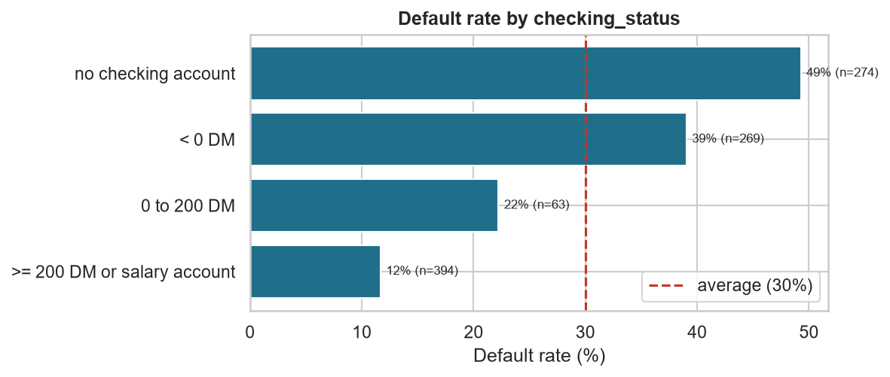
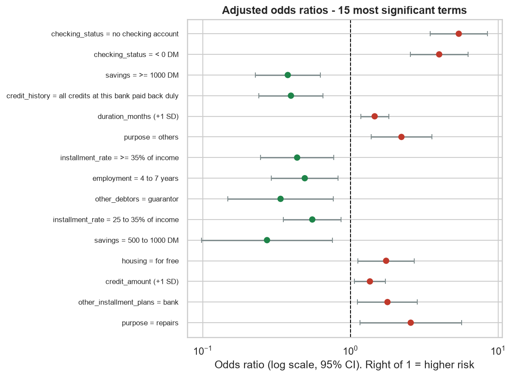
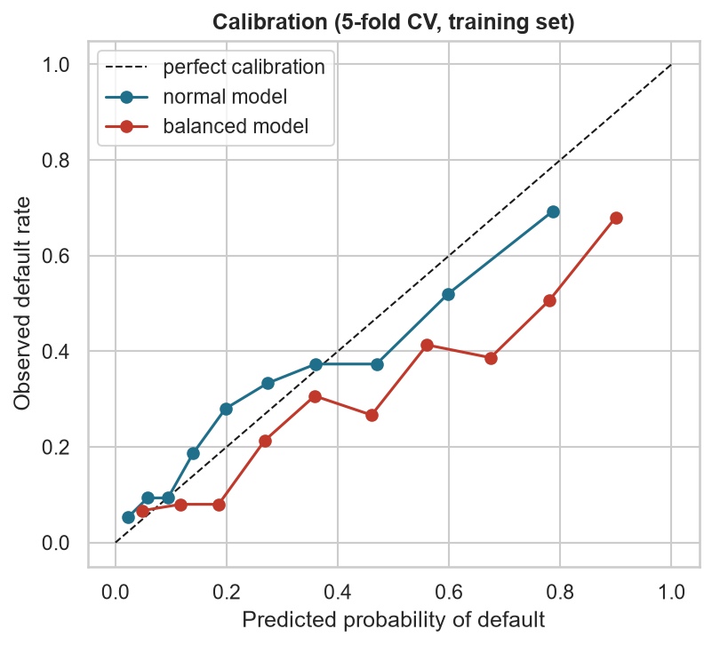
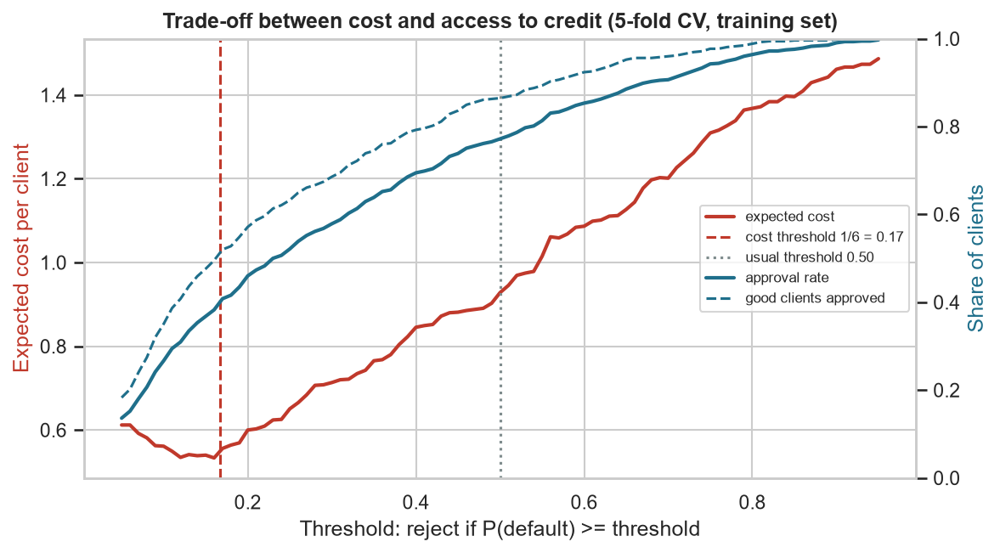
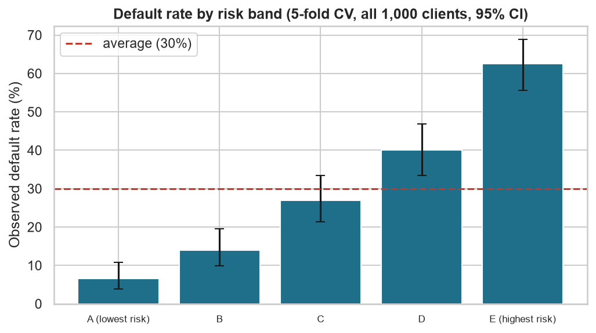
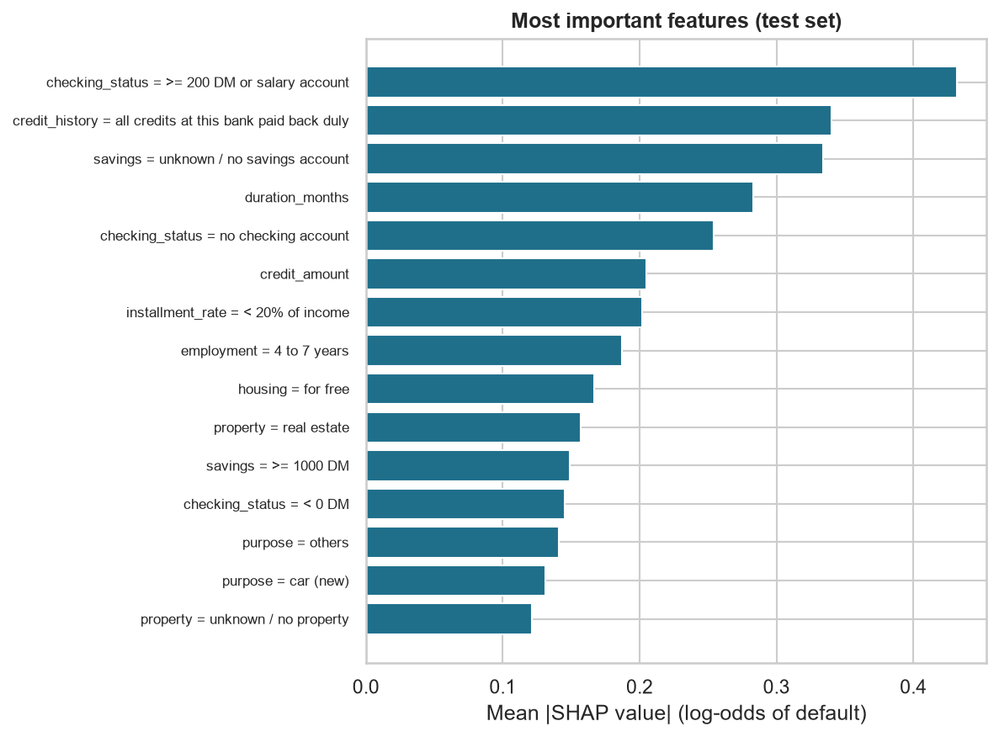
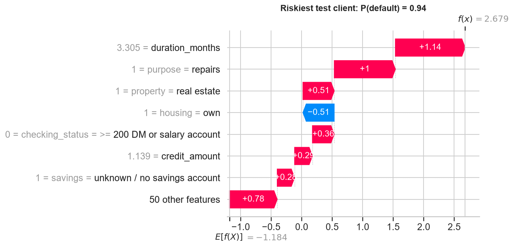
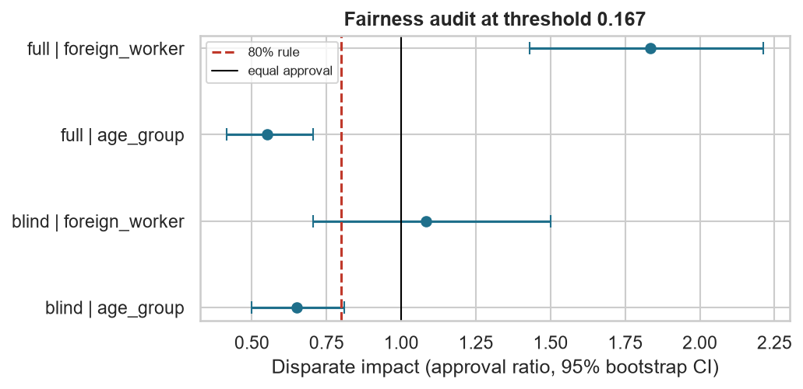

# Abbreviations

| Abbreviation | Meaning |
| --- | --- |
| AI | Artificial Intelligence |
| AUC | Area Under the Curve (here: area under the ROC curve) |
| CI | Confidence Interval (here always 95%) |
| CSV | Comma-Separated Values (a simple table file) |
| CV | Cross-Validation |
| DI | Disparate Impact (approval rate of one group divided by the approval rate of another) |
| DM | Deutsche Mark (German currency before the euro) |
| EO | Equal Opportunity (good payers should have the same chance of approval in every group) |
| EU | European Union |
| FN | False Negative (a client who defaults but was approved) |
| FP | False Positive (a good client who was rejected) |
| OR | Odds Ratio |
| PD | Probability of Default |
| ROC | Receiver Operating Characteristic (curve of true vs false positive rates) |
| SD | Standard Deviation |
| SHAP | SHapley Additive exPlanations (a method to explain each prediction) |
| SQL | Structured Query Language (language to query databases) |
| UCI | University of California, Irvine (hosts the Machine Learning Repository) |

# 1. Summary

This project studies 1,000 past consumer loans from a German bank. It asks two questions:
which client characteristics are associated with loan default, and how a lender can evaluate
underserved clients in a fairer way.

| Topic | Main result |
| --- | --- |
| Data | 1,000 loans, 30% bad credits. The original code table was wrong for 8 variables; we use the corrected table of Grömping (2019). |
| Strongest factors | Checking account status, credit history, loan duration and savings. |
| Model | Logistic regression without sex, age or foreign-worker status. Test ROC-AUC = 0.80. |
| Decision rule | Threshold P(default) = 1/6 from the 5:1 cost matrix. It saves 22% compared with the best simple rule ("reject everyone"). |
| Access to credit | At this threshold only 40% of applicants and 51% of good clients are approved. |
| Risk bands | Default rate goes from 6.5% (safest 20%) to 62.5% (riskiest 20%). |
| Fairness | Clients aged 25 or less are approved much less often, even though the model does not use age (DI = 0.65). |

**Main message.** A simple and transparent model can separate risk well. But the decision
threshold is a business and social choice, not only a technical one. Fairness must be
measured, not assumed. These are historical correlations from the 1970s. They do not prove
that any person is or is not creditworthy.

# 2. Problem and research questions

Banks must estimate the risk that a borrower will not repay. If they lend to too many risky
clients, they lose money. If they are too strict, good clients lose access to credit. This is
a real problem for financial inclusion: in 2021 about 1.4 billion adults in the world still
had no bank account (Demirgüç-Kunt et al., 2022), and people with a short or unusual financial
history are often refused. In the European Union, credit scoring systems are now classified
as "high-risk" AI systems (European Union, 2024), so they must be transparent and checked
for discrimination.

We answer four questions:

- **Q1.** Which client characteristics are associated with default?
- **Q2.** Can a simple, interpretable model separate good and bad clients?
- **Q3.** Which decision rule gives the lowest cost, and what does it mean for access to credit?
- **Q4.** Does the model treat some groups worse, even without using sensitive data?

# 3. Data

## 3.1 Source

We use the public **Statlog (German Credit Data)** dataset from the UCI Machine Learning
Repository (Hofmann, 1994). It contains 1,000 loans, 20 client and loan characteristics and
one target: good credit (repaid as agreed) or bad credit (not repaid as agreed). 30% of the
loans are bad. The dataset comes with a **cost matrix**: approving a client who then defaults
costs 5, rejecting a good client costs 1.

## 3.2 An important problem: the original code table is wrong

The raw file uses codes such as `A11` or `A34`. The code table delivered with the data
explains these codes. Grömping (2019) went back to the original German sources and showed
that this table is **wrong for 8 of the 20 variables**. Here are the most important corrections:

| Variable | Original (wrong) label | Correct label |
| --- | --- | --- |
| checking_status A11 | balance < 0 DM | no checking account |
| checking_status A14 | no checking account | balance >= 200 DM or salary account |
| credit_history A30 | no credits taken | delay in paying off in the past |
| credit_history A34 | critical account | all credits at this bank paid back duly |
| foreign_worker A201 | yes (963 clients) | no (only 37 clients are foreign workers) |
| personal_status_sex A92 | female | female non-single **or** male single |

We discovered this because our first results did not make sense: "no checking account" and
"critical account" seemed to be the *safest* clients. After the correction, the results become
logical (Section 5.1). **Lesson:** always check that results make sense, and check the data
documentation.

Grömping (2019) gives two more facts that matter for this study:

1. The loans are from **1973 to 1975**, from a large bank in southern Germany.
2. Bad credits were **deliberately oversampled**. In reality only about **5%** of loans were
   bad, not 30%. The bank chose 300 bad and 700 good loans to have enough bad cases.

## 3.3 Limits of the data

- **Selection bias.** We only see clients who *received* a loan. People who were refused are
  missing, so we do not know if they would have repaid (Thomas et al., 2017; Banasik & Crook, 2007).
- **Old and small.** 1,000 loans from the 1970s. The results show method, not today's reality.
- **Sex cannot be used.** Because code A92 mixes women and single men, sex cannot be
  recovered from the data. We therefore do not audit sex.
- **Very few foreign workers.** Only 37 people, so any result about this group is uncertain.

# 4. Method: the five steps

All steps are Python scripts in `src/`. `python src/run_all.py` runs everything and saves the
tables and figures in `results/`. The random seed is fixed (42), so the results are always the same.

**Step 1: data preparation and SQL** (`01_data_prep.py`). We load the raw file and apply the
corrected code table. We store the data in a SQLite database and use SQL to compute default
rates by segment (checking account, credit history, purpose, age band).

**Step 2: statistical analysis** (`02_statistics.py`, question Q1).

- For each categorical variable: a **chi-square test** of independence and **Cramér's V** to
  measure the strength of the link, from 0 (no link) to 1 (perfect link) (Agresti, 2013).
- For each numeric variable: a **Mann-Whitney U test** (Mann & Whitney, 1947), which does not
  assume a normal distribution, and the **rank-biserial correlation** as effect size (Kerby, 2014).
- We run 20 tests, so some could be significant by chance. We use the **Bonferroni
  correction**: each p-value is multiplied by the number of tests (Bland & Altman, 1995).
- Then a **multivariable logistic regression** shows the effect of each factor "all other
  things being equal". We report **odds ratios** (OR) with 95% CI: OR > 1 means higher risk,
  OR < 1 means lower risk (Hosmer et al., 2013). Numeric variables are standardised, so their
  OR is for +1 standard deviation.

**Step 3: model, threshold and risk segmentation** (`03_model.py`, questions Q2 and Q3).

- *Split.* 75% of the data for training (750 loans), 25% for the final test (250 loans).
  The test set is used only once, at the end.
- *Model.* A logistic regression. It is the standard model in credit scoring (Siddiqi, 2017;
  Hand & Henley, 1997) and is still hard to beat (Lessmann et al., 2015). It is also easy to
  explain, which matters for high-stakes decisions (Rudin, 2019). We do **not** use sex
  (personal_status_sex), age or foreign-worker status.
- *Class imbalance.* There are fewer bad credits (30%) than good ones (70%). A common fix
  is to give more weight to the small class (`class_weight="balanced"`) (He & Garcia, 2009).
  We compare this with a normal model, using 5-fold cross-validation on the training set.
- *Decision threshold.* We reject a client when P(default) ≥ threshold. With the costs
  5 (FN) and 1 (FP), decision theory gives the threshold 1 / (1 + 5) = **0.167** (Elkan, 2001).
  This formula is only valid if the predicted probabilities are realistic (calibrated).
- *Comparison.* We compare the model with two simple rules: approve everyone and reject everyone.
- *Risk bands.* We give each of the 1,000 clients a cross-validated score (a model that did not
  see this client during training) and split them into 5 equal bands. For each band we compute
  the default rate with a 95% Wilson confidence interval (Wilson, 1927).

**Step 4: explaining the model with SHAP** (`04_shap.py`). SHAP values show how much each
feature pushes one prediction up or down (Lundberg & Lee, 2017). For a logistic regression,
the SHAP value is simply *coefficient × (client value − average value)* (Molnar, 2022). Our
script checks this formula: the difference is 0.

**Step 5: fairness audit** (`05_fairness.py`, question Q4). We use cross-validated scores for
all 1,000 clients and the threshold 0.167. Groups: age ≤ 25 vs > 25 (the split used by
Kamiran & Calders, 2009, on this dataset) and foreign workers vs others. We compute:

- **Disparate impact (DI)**: approval rate of the group ÷ approval rate of the reference group.
  The "80% rule" (four-fifths rule) flags a problem when DI < 0.8 (EEOC, 1978; Feldman et al., 2015).
- **Equal opportunity (EO) gap**: difference in approval rate *among good payers only*. People
  who would repay should have the same chance in every group (Hardt et al., 2016).
- **95% bootstrap CI**: we resample the clients 2,000 times to see how stable each number is
  (Efron & Tibshirani, 1993).
- **Blind vs full model**: a model without sensitive data vs a model with age and foreign-worker
  status, to see if removing these variables removes the gaps.

# 5. Results

## 5.1 Who defaults? (SQL, Step 1)

| Checking account | Clients | Default rate |
| --- | --- | --- |
| no checking account | 274 | **49.3%** |
| balance < 0 DM | 269 | 39.0% |
| 0 to 200 DM | 63 | 22.2% |
| >= 200 DM or salary account | 394 | **11.7%** |

| Credit history | Clients | Default rate |
| --- | --- | --- |
| delay in paying off in the past | 40 | **62.5%** |
| critical account / credits elsewhere | 49 | 57.1% |
| no credits taken / all paid back duly | 530 | 31.9% |
| existing credits paid back duly | 88 | 31.8% |
| all credits at this bank paid back duly | 293 | **17.1%** |

With the corrected labels, the results are logical: clients without a checking account or with
past payment delays default most often. Clients with a good balance or a good history with the
bank default least often. Defaulted loans are also larger (3,938 vs 2,985 DM on average) and
longer (24.9 vs 19.2 months). Young clients (19 to 25) default more often (42.1%) than clients
aged 36 to 50 (23.7%).

{width=80%}

## 5.2 Statistical tests and logistic regression (Q1)

After the Bonferroni correction, 10 of the 20 variables are significantly linked to default.
The strongest are:

| Variable | Effect size | Bonferroni p-value |
| --- | --- | --- |
| checking_status | Cramér's V = 0.35 | < 0.001 |
| duration_months | rank-biserial r = 0.26 | < 0.001 |
| credit_history | Cramér's V = 0.25 | < 0.001 |
| savings | Cramér's V = 0.19 | < 0.001 |
| purpose | Cramér's V = 0.18 | 0.002 |
| property | Cramér's V = 0.15 | < 0.001 |
| age | rank-biserial r = −0.14 | 0.008 |

All effects are small to medium. No single variable predicts default on its own.

The logistic regression (reference = most frequent category) gives these main odds ratios:

| Term | OR | 95% CI | Effect |
| --- | --- | --- | --- |
| checking_status = no checking account | 5.41 | 3.45 to 8.47 | higher risk |
| checking_status = < 0 DM | 3.98 | 2.54 to 6.26 | higher risk |
| purpose = others | 2.21 | 1.38 to 3.56 | higher risk |
| duration_months (+1 SD) | 1.46 | 1.17 to 1.81 | higher risk |
| credit_amount (+1 SD) | 1.35 | 1.06 to 1.73 | higher risk |
| savings = >= 1000 DM | 0.38 | 0.23 to 0.62 | lower risk |
| credit_history = all credits at this bank paid back duly | 0.40 | 0.24 to 0.65 | lower risk |
| other_debtors = guarantor | 0.34 | 0.15 to 0.76 | lower risk |
| installment_rate = >= 35% of income | 0.44 | 0.25 to 0.77 | lower risk |

The reference for checking_status is ">= 200 DM", so a client with no checking account has about
5 times higher odds of default than a client with a good balance, all other things being equal.

{width=85%}

**A surprising result.** Clients who pay a *large* share of their income (≥ 35%) default *less*
often. This is probably **selection**: the bank only accepted such heavy loans for clients it
trusted for other reasons. This shows why we must speak of **associations, not causes**.

**Answer to Q1.** Checking account status, credit history, loan duration, loan amount and
savings are the factors most strongly associated with default in this sample.

## 5.3 Model performance and class imbalance (Q2)

| Model (5-fold CV, training set) | ROC-AUC | Average predicted PD | Real default rate | Brier score |
| --- | --- | --- | --- | --- |
| normal | 0.759 | 0.300 | 0.300 | 0.176 |
| balanced | 0.758 | 0.435 | 0.300 | 0.200 |

Both models rank clients in the same way (same ROC-AUC). But the "balanced" model predicts
an average default probability of 43.5% when the real rate is 30%: its probabilities are
too high. Its Brier score (a measure of probability error; Brier, 1950) is also worse. This is
a known effect of reweighting (Elkan, 2001; Niculescu-Mizil & Caruana, 2005). Because the
threshold formula needs realistic probabilities, **we keep the normal model** and handle the
imbalance with the threshold.

{width=55%}

On the test set, the final model reaches **ROC-AUC = 0.80**. An AUC of 0.5 means random
guessing and 1.0 a perfect ranking (Fawcett, 2006), so the model is useful but far from perfect.

## 5.4 Decision threshold and financial trade-off (Q3)

On the training set, the threshold with the lowest cost is 0.16, very close to the theory
(0.167). Results on the test set (250 clients):

| Rule | Approval rate | Good clients approved | Defaulters approved | Cost per client | Saving vs best simple rule |
| --- | --- | --- | --- | --- | --- |
| Approve everyone | 100% | 100% | 100% | 1.500 | — |
| Reject everyone | 0% | 0% | 0% | 0.700 | reference |
| Model, threshold 0.50 | 73.6% | 86.3% | 44.0% | 0.756 | −8% |
| **Model, threshold 0.167** | **39.6%** | **50.9%** | **13.3%** | **0.544** | **+22%** |

{width=85%}

**What this means.**

1. The usual threshold of 0.50 is a bad choice here. It costs *more* than rejecting everyone,
   because it approves 44% of the defaulters.
2. The cost-based threshold 0.167 is the best rule, but the saving compared with "reject
   everyone" is 22%, not more. (Comparing with "approve everyone" would show 64%, but this
   comparison is too easy.)
3. The price is access to credit: **half of the good clients are refused**. This is the core
   trade-off between financial risk and financial inclusion.
4. The 5:1 ratio and the 30% default rate push towards refusal. In reality only about 5% of
   loans were bad (Grömping, 2019). If we correct the probabilities to a 5% default rate
   (prior correction; Saerens et al., 2002; King & Zeng, 2001), the same threshold approves
   **87%** of applicants instead of 40%. A lender must therefore use its *own* default rate
   and its *own* costs. A more complete approach would use real profit and loss numbers
   (Verbraken et al., 2014).

## 5.5 Risk segmentation

| Band | Clients | Default rate | 95% CI | Suggested action |
| --- | --- | --- | --- | --- |
| A (lowest risk) | 200 | 6.5% | 3.8% to 10.8% | approve, standard terms |
| B | 200 | 14.0% | 9.9% to 19.5% | approve, standard terms |
| C | 200 | 27.0% | 21.3% to 33.5% | approve with a smaller amount or shorter duration |
| D | 200 | 40.0% | 33.5% to 46.9% | manual review (guarantor, collateral) |
| E (highest risk) | 200 | 62.5% | 55.6% to 68.9% | decline, or secured loan only |

{width=70%}

The default rate rises in every band, and the confidence intervals of A and E are far apart.
Instead of a simple yes/no, a bank can **adapt the loan conditions** to the risk band (amount,
duration, guarantor), as is usual with credit scorecards (Siddiqi, 2017). This "adapt instead of
refuse" approach helps inclusion: a client in band C or D can still get a loan, with safer terms.
(These actions are suggestions for illustration, not tested policies.)

## 5.6 Explaining the model with SHAP

The most important features (average absolute SHAP value, test set) are:

1. checking_status = ">= 200 DM or salary account" (lowers the risk)
2. credit_history = "all credits at this bank paid back duly" (lowers the risk)
3. savings = "unknown / no savings account" (raises the risk)
4. duration_months (longer loans raise the risk)
5. checking_status = "no checking account" (raises the risk)

{width=80%}

The waterfall plots explain one decision for one client. For example, for the riskiest client
of the test set, the long loan duration and the purpose "repairs" add the most risk. This is the
kind of explanation a bank should be able to give to a client who is refused.

{width=85%}

For a linear model, SHAP gives no new information compared with the coefficients. Its value is
to present the information **per client**, in a clear way. Some effects look strange (for
example, owning real estate slightly raises the risk). As in Section 5.2, they probably reflect
the bank's past choices and should not be over-interpreted.

## 5.7 Fairness audit (Q4)

| Model | Group (n) | Approval: group vs reference | DI [95% CI] | EO gap [95% CI] |
| --- | --- | --- | --- | --- |
| blind | age ≤ 25 (190) | 27.9% vs 42.8% | **0.65** [0.50, 0.81] | −12 pts [−22, −2] |
| blind | foreign worker (37) | 43.2% vs 39.9% | 1.08 [0.71, 1.50] | −3 pts [−20, +15] |
| full | age ≤ 25 (190) | 24.7% vs 44.8% | 0.55 [0.42, 0.70] | −18 pts [−28, −8] |
| full | foreign worker (37) | 73.0% vs 39.8% | 1.84 [1.43, 2.21] | +24 pts [+8, +38] |

{width=75%}

**Age.** The blind model does not use age, but young clients are approved much less often
(DI = 0.65, below the 80% rule). Even among *good payers*, young clients are approved 12
points less often. Part of the gap comes from the data: young clients default more often in
this sample (42% vs 27%). But other variables linked to age (short employment, no savings,
renting) carry this information into the model. **Removing the sensitive variable reduces
the gap (DI 0.55 → 0.65), but does not remove it.** This is called proxy discrimination
(Pope & Sydnor, 2011; Barocas et al., 2023).

**Foreign workers.** With only 37 people, the confidence interval of the blind model is very
wide (0.71 to 1.50). We cannot conclude. In the full model, foreign workers are approved
*more* often, because in this sample they default less (11% vs 31%). This shows that adding a
sensitive variable can change results in either direction.

**Sex.** Not audited, because sex cannot be recovered from the data (Section 3.2). Several
past studies used a "sex" column built from the wrong code table; their conclusions about sex
should be read with care.

**Accuracy cost of removing sensitive data.** The blind model has a CV ROC-AUC of 0.775, the
full model 0.778. Removing age and foreign-worker status costs almost nothing in accuracy.
Kozodoi et al. (2022) also find that fairness can often be improved at a small profit cost.

# 6. Discussion: how can a lender evaluate underserved clients more fairly?

Based on our results and the literature, we suggest five practical rules:

1. **Use transparent models first.** A logistic regression reaches ROC-AUC 0.80 and each
   decision can be explained to the client.
2. **Do not use sensitive data in the model, but do use it to audit.** Removing age did not
   remove the age gap. Without measuring, the bank would not see the problem
   (Barocas et al., 2023).
3. **Choose the threshold on purpose.** The threshold decides how many good clients lose
   access to credit. It should use the bank's real default rate and real costs, and be
   written down and reviewed.
4. **Adapt conditions instead of refusing.** Risk bands allow a smaller amount, a shorter
   duration or a guarantor for higher-risk clients.
5. **Remember selection bias.** The model only learned from past approved clients. Groups that
   were often refused in the past are under-represented. Methods such as reject inference
   exist, but their benefit is often small (Banasik & Crook, 2007), so the best solution is
   to collect better data (for example, by approving a small random sample of borderline clients).

# 7. Limitations

- **Correlation is not creditworthiness.** The model finds patterns in past data. It does not
  show that a characteristic *causes* default, and it must not be used to judge a person.
- **Selection bias** (only approved clients) and **oversampling** (30% instead of 5% bad credits).
- **Old, small, local data:** 1,000 loans from southern Germany, 1973 to 1975. Credit amounts
  were also transformed by an unknown function (Grömping, 2019).
- **Small groups:** 37 foreign workers; the fairness results for this group are not reliable.
- **Simple cost matrix:** the 5:1 ratio is a convention given with the dataset, not real bank data.
- **No fairness correction:** we measured the gaps but did not test methods to reduce them.
  This would be a good next step (Kozodoi et al., 2022).

# 8. Conclusion

On a public dataset, and after correcting its code table, a simple logistic regression
separates risk well (test ROC-AUC 0.80; default rate from 6.5% to 62.5% across risk bands).
The decision threshold based on the cost matrix (0.167) saves 22% compared with the best
simple rule, but it refuses half of the good clients. This shows the real trade-off between
risk and inclusion. The fairness audit shows that removing sensitive data is not enough:
young clients are still approved much less often. Historical correlations can help to organise
lending decisions, but they are a starting point for human judgement, never a verdict on a person.

# References

Agresti, A. (2013). *Categorical Data Analysis* (3rd ed.). Wiley.
*(Step 2: chi-square test, Cramér's V, odds ratios.)*

Banasik, J., & Crook, J. (2007). Reject inference, augmentation, and sample selection.
*European Journal of Operational Research, 183*(3), 1582–1594. https://doi.org/10.1016/j.ejor.2006.06.072
*(Selection bias, reject inference.)*

Barocas, S., Hardt, M., & Narayanan, A. (2023). *Fairness and Machine Learning: Limitations and
Opportunities*. MIT Press. https://fairmlbook.org
*(Why removing sensitive variables is not enough.)*

Bland, J. M., & Altman, D. G. (1995). Multiple significance tests: the Bonferroni method.
*BMJ, 310*(6973), 170. https://doi.org/10.1136/bmj.310.6973.170
*(Step 2: Bonferroni correction.)*

Brier, G. W. (1950). Verification of forecasts expressed in terms of probability.
*Monthly Weather Review, 78*(1), 1–3.
*(Step 3: Brier score.)*

Demirgüç-Kunt, A., Klapper, L., Singer, D., & Ansar, S. (2022). *The Global Findex Database 2021:
Financial Inclusion, Digital Payments, and Resilience in the Age of COVID-19*. World Bank.
https://doi.org/10.1596/978-1-4648-1897-4
*(Context: financial inclusion.)*

Efron, B., & Tibshirani, R. J. (1993). *An Introduction to the Bootstrap*. Chapman & Hall.
*(Step 5: bootstrap confidence intervals.)*

Elkan, C. (2001). The foundations of cost-sensitive learning. In *Proceedings of the 17th
International Joint Conference on Artificial Intelligence (IJCAI)* (pp. 973–978).
*(Step 3: threshold = C_FP / (C_FP + C_FN); effect of reweighting on probabilities.)*

Equal Employment Opportunity Commission [EEOC]. (1978). Uniform Guidelines on Employee Selection
Procedures, 29 C.F.R. § 1607.4(D).
*(Step 5: the "four-fifths" (80%) rule.)*

European Union. (2024). Regulation (EU) 2024/1689 laying down harmonised rules on artificial
intelligence (Artificial Intelligence Act), Annex III. *Official Journal of the European Union*.
*(Context: credit scoring is a high-risk AI use.)*

Fawcett, T. (2006). An introduction to ROC analysis. *Pattern Recognition Letters, 27*(8), 861–874.
https://doi.org/10.1016/j.patrec.2005.10.010
*(Step 3: ROC-AUC.)*

Feldman, M., Friedler, S. A., Moeller, J., Scheidegger, C., & Venkatasubramanian, S. (2015).
Certifying and removing disparate impact. In *Proceedings of the 21st ACM SIGKDD Conference*
(pp. 259–268). https://doi.org/10.1145/2783258.2783311
*(Step 5: disparate impact.)*

Grömping, U. (2019). *South German Credit Data: Correcting a Widely Used Data Set* (Report 4/2019).
Reports in Mathematics, Physics and Chemistry, Beuth University of Applied Sciences Berlin.
*(Data: corrected code table, 1973–1975, 5% real default rate, sex cannot be recovered.)*

Hand, D. J., & Henley, W. E. (1997). Statistical classification methods in consumer credit scoring:
a review. *Journal of the Royal Statistical Society: Series A, 160*(3), 523–541.
*(Step 3: logistic regression in credit scoring.)*

Hardt, M., Price, E., & Srebro, N. (2016). Equality of opportunity in supervised learning.
In *Advances in Neural Information Processing Systems 29* (pp. 3315–3323).
*(Step 5: equal opportunity.)*

He, H., & Garcia, E. A. (2009). Learning from imbalanced data. *IEEE Transactions on Knowledge and
Data Engineering, 21*(9), 1263–1284. https://doi.org/10.1109/TKDE.2008.239
*(Step 3: class imbalance.)*

Hofmann, H. (1994). *Statlog (German Credit Data)* [Dataset]. UCI Machine Learning Repository.
https://doi.org/10.24432/C5NC77
*(Data source.)*

Hosmer, D. W., Lemeshow, S., & Sturdivant, R. X. (2013). *Applied Logistic Regression* (3rd ed.). Wiley.
*(Step 2: logistic regression and odds ratios.)*

Kamiran, F., & Calders, T. (2009). Classifying without discriminating. In *2nd International
Conference on Computer, Control and Communication (IC4)* (pp. 1–6). IEEE.
*(Step 5: age ≤ 25 as the protected group in this dataset.)*

Kerby, D. S. (2014). The simple difference formula: An approach to teaching nonparametric
correlation. *Comprehensive Psychology, 3*, Article 1. https://doi.org/10.2466/11.IT.3.1
*(Step 2: rank-biserial correlation.)*

King, G., & Zeng, L. (2001). Logistic regression in rare events data. *Political Analysis, 9*(2),
137–163.
*(Step 3: correcting probabilities when one class was oversampled.)*

Kozodoi, N., Jacob, J., & Lessmann, S. (2022). Fairness in credit scoring: Assessment,
implementation and profit implications. *European Journal of Operational Research, 297*(3),
1083–1094. https://doi.org/10.1016/j.ejor.2021.06.023
*(Step 5 and discussion: fairness vs profit in credit scoring.)*

Lessmann, S., Baesens, B., Seow, H.-V., & Thomas, L. C. (2015). Benchmarking state-of-the-art
classification algorithms for credit scoring: An update of research. *European Journal of
Operational Research, 247*(1), 124–136. https://doi.org/10.1016/j.ejor.2015.05.030
*(Step 3: logistic regression as a strong benchmark.)*

Lundberg, S. M., & Lee, S.-I. (2017). A unified approach to interpreting model predictions.
In *Advances in Neural Information Processing Systems 30* (pp. 4765–4774).
*(Step 4: SHAP.)*

Mann, H. B., & Whitney, D. R. (1947). On a test of whether one of two random variables is
stochastically larger than the other. *The Annals of Mathematical Statistics, 18*(1), 50–60.
*(Step 2: Mann-Whitney U test.)*

Molnar, C. (2022). *Interpretable Machine Learning: A Guide for Making Black Box Models
Explainable* (2nd ed.). https://christophm.github.io/interpretable-ml-book/
*(Step 4: SHAP value of a linear model = coefficient × (value − mean).)*

Niculescu-Mizil, A., & Caruana, R. (2005). Predicting good probabilities with supervised learning.
In *Proceedings of the 22nd International Conference on Machine Learning* (pp. 625–632).
*(Step 3: calibration.)*

Pope, D. G., & Sydnor, J. R. (2011). Implementing anti-discrimination policies in statistical
profiling models. *American Economic Journal: Economic Policy, 3*(3), 206–231.
https://doi.org/10.1257/pol.3.3.206
*(Step 5: proxy effects when a sensitive variable is removed.)*

Rudin, C. (2019). Stop explaining black box machine learning models for high stakes decisions and
use interpretable models instead. *Nature Machine Intelligence, 1*(5), 206–215.
https://doi.org/10.1038/s42256-019-0048-x
*(Step 3: choice of an interpretable model.)*

Saerens, M., Latinne, P., & Decaestecker, C. (2002). Adjusting the outputs of a classifier to new
a priori probabilities: A simple procedure. *Neural Computation, 14*(1), 21–41.
https://doi.org/10.1162/089976602753284446
*(Step 3: prior correction from 30% to 5%.)*

Siddiqi, N. (2017). *Intelligent Credit Scoring: Building and Implementing Better Credit Risk
Scorecards* (2nd ed.). Wiley.
*(Steps 3 and 5.5: scorecards, risk bands.)*

Thomas, L. C., Crook, J., & Edelman, D. (2017). *Credit Scoring and Its Applications* (2nd ed.).
SIAM.
*(Context: credit scoring, default, selection bias.)*

Verbraken, T., Bravo, C., Weber, R., & Baesens, B. (2014). Development and application of consumer
credit scoring models using profit-based classification measures. *European Journal of Operational
Research, 238*(2), 505–513.
*(Section 5.4: profit-based evaluation.)*

Wilson, E. B. (1927). Probable inference, the law of succession, and statistical inference.
*Journal of the American Statistical Association, 22*(158), 209–212.
*(Step 3: Wilson confidence interval.)*

**Software:** Python 3.12, pandas, NumPy, SciPy, statsmodels, scikit-learn, SHAP, matplotlib,
seaborn, SQLite.
